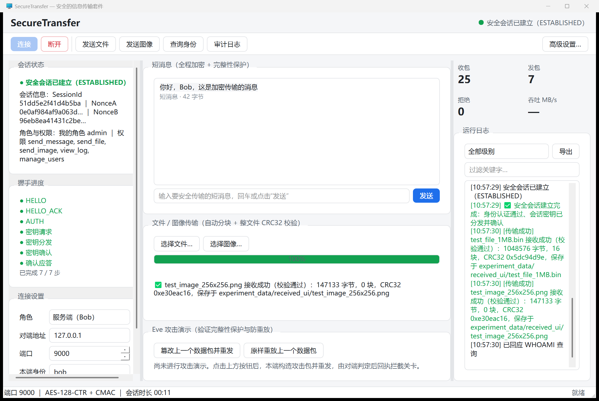
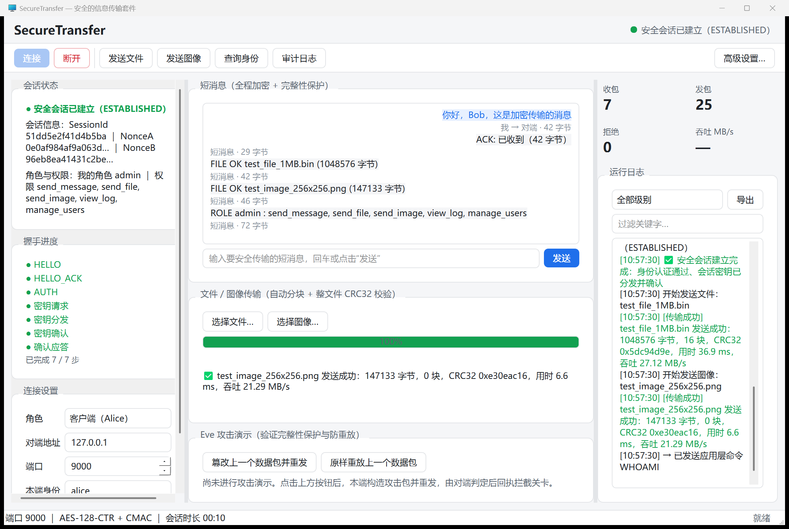

# 图形界面（课程要求 8）

> 课程要求 8：**有良好的人机交互界面、合适的应用需求分析、合理的应用设计**（加分项）。
> 本文说明界面的方案选择、功能设计、运行方式与已知限制。
>
> **2026-10-01 更新**：项目已迁移到 Windows，界面在 Windows 上也能编译运行
> （MSYS2 `mingw-w64-x86_64-qt5`，Qt 5.15.19），见本文 §10。

---

## 1. 结论摘要

| 项目 | 内容 |
| --- | --- |
| 技术栈 | **Qt 5.12 Widgets（C++）**，与安全内核同一进程，直接调用 `SecureSession` / `FileSender` / `AccessController` |
| 代码量 | 4 个源文件约 1900 行（`apps/ui/main.cpp`、`app_theme.h`、`main_window.*`、`session_worker.*`） |
| 界面语言 | 中文（少量通用术语用英文，如 SessionId、CRC32、IMAGE） |
| 运行位置 | Windows 桌面（主力）/ 虚拟机桌面（`DISPLAY=:0`） |
| 截图 | [`docs/screenshots/`](screenshots/README.md)（服务端视角 + 客户端视角各一张；改版后见 §12） |
| 关键设计 | **界面不实现任何密码学逻辑**：加密 / 完整性 / 认证 / 密钥分发 / 防重放 / 访问控制全部复用已有模块 |
| 改版 | **2026-10-09**：按 `docs/SecureTransfer_UI改造草图.html` 重做外壳与三栏布局，新增握手 7 步进度、Eve 攻击面板、日志分级/过滤/导出 → 见 **§12** |

## 2. 需求分析（界面要解决什么问题）

课程要求"使上述安全操作尽量对用户透明"。所以界面要解决三件事：

1. **用户不需要敲命令**：连接对象、端口、身份、策略都能在界面上选；
2. **安全过程可见但不需要理解**：握手每一步、会话标识、算法、角色权限、收发包统计都自动显示，
   用户只看到"已建立安全会话 / 已安全发送"；
3. **能演示与验证**：文件 / 图像传输有进度与校验结果，攻击演示有一键按钮，
   被访问控制拒绝时给出明确原因。

## 3. 界面分区

> 2026-10-09 改版后（视觉与分区以 `docs/SecureTransfer_UI改造草图.html` 为准）：
> **标题条 → 工具条 → 三栏 → 状态栏**。

| 区域 | 控件 | 作用 |
| --- | --- | --- |
| 标题条 | 左 "SecureTransfer"／右 状态灯 + 状态文字 | 未连接（灰）/ 连接中（黄）/ 已建立（绿）/ 已结束（红）一目了然 |
| 工具条 | [连接] [断开] │ [发送文件] [发送图像] [查询身份] [审计日志] … [高级设置…] | 常用动作一屏可达；"查询身份""审计日志"对应 `CMD WHOAMI` / `CMD VIEW_LOG`（后者仅管理员可用） |
| 左栏 ・会话状态 | 状态行 + 会话信息（SessionId、NonceA/B）+ 角色与权限 | SessionId 与 Nonce 是"本次会话"的指纹 |
| 左栏 ・握手进度 | 7 步清单（HELLO / HELLO_ACK / AUTH / 密钥请求 / 密钥分发 / 密钥确认 / 确认应答） | 由内核 `onHandshakeStep` 回调实时点亮，握手不再是黑盒 |
| 左栏 ・连接设置 | 角色（客户端/服务端）、对端地址、端口、本端身份 + 参数摘要 | 一个界面既能当 Alice 也能当 Bob；身份可从 alice / eve / mallory / bob 里选 |
| 中栏 ・短消息 | 气泡式历史（本端蓝底右对齐 / 对端灰底左对齐）+ 输入框 + [发送] | 明文直接输入，加密在后台完成 |
| 中栏 ・文件 / 图像传输 | [选择文件…] [选择图像…] + 进度条 + 结果标签 | 走第四轮的分块 / 单包传输，显示 CRC32 校验结果 |
| 中栏 ・Eve 攻击演示 | [篡改上一个数据包并重发] [原样重放上一个数据包] + 三段式结果面板 | 显示"动作 → 对端拦截关卡 → 结果"，关卡来自内核 `RejectGate` |
| 右栏 ・统计 | 2×2 数字块：收包 / 发包 / 拒绝 / 吞吐（MB/s） | 数字来自 `ProtocolStats` 摘要，吞吐按会话时长折算 |
| 右栏 ・运行日志 | 日志视图 + 级别下拉 + 关键字过滤 + [导出] | 按级别着色；握手每一步、访问控制判定、传输细节都写在这里，可导出为 UTF-8 文本 |
| 状态栏 | 端口 ｜ AES-128-CTR + CMAC ｜ 会话时长 ｜ 就绪 | 会话时长每秒刷新 |
| 高级设置（对话框） | 对端身份、密钥配置、访问策略、接收目录、审计日志 | 建链参数不再占用主界面；下次"连接"时生效 |

## 4. 关键设计决策

### 4.1 线程模型：安全会话跑在独立线程

`SecureSession::receiveMessage()` 是阻塞调用，直接放在 GUI 线程里会让界面卡死。
因此：

* **GUI 线程**只画界面，把"发消息 / 发文件 / 发命令"塞进一个加锁队列；
* **工作线程**独占 `SecureSession`（该对象不是线程安全的），循环做
  "先执行队列里的命令 → 再调用 `tryReceiveMessage(type, body, 100)` 等数据"；
* 结果通过 Qt 信号发回 GUI 线程（自动跨线程排队），界面始终可交互。

**消息延迟**：`tryReceiveMessage()` 内部用 `select()` 等"可读"，对端一发数据就立刻返回，
所以消息的显示延迟不受那个 100 ms 空闲等待限制；100 ms 只是"没有数据时，最多隔多久
再回头看一眼命令队列"的上限，也就是说点击"发送"最多延迟 100 ms 执行。

> 2026-10-01 之前这里是"用 250 ms 超时接收 + 把超时当没有数据"：
> 既让消息最多晚 250 ms 显示，又会为每次超时打一行 ERROR 日志（空闲几秒就是几百行）。
> 现在这版实现消除了这两个问题，见 [`history_rounds.md`](history_rounds.md) §24。

### 4.2 界面与安全内核解耦

界面**没有**任何加密、MAC、密钥派生代码，只是调用：

```cpp
SecureSession      // 握手 + 加密数据通道
transfer::FileSender / TransferReceiver   // 文件 / 图像
access::AccessController                  // 访问控制与审计
```

这样既满足课程要求 4（密码算法必须自己写，且不会被界面"绕过"），
也意味着界面代码量小（约 1100 行）而功能完整。

### 4.3 可脚本化（`--auto`）

界面支持命令行参数，便于演示与自动截图：

```bash
./st_ui --help
./st_ui --server --id bob --peer alice --port 9400 --auto
./st_ui --client --auto --send-text "你好" --cmd WHOAMI \
    --send-file /path/test_file_1MB.bin --send-image /path/test_image_256x256.png
```

## 5. 界面截图


上图：图形界面作为**服务端**接收命令行 Alice 的消息、ACCESS/审计、1 MB 文件与图像。


上图：图形界面作为**客户端**，自动发送中文短消息、查询角色、发 1 MB 文件与图像。

**2026-10-09 改版后**（同一场景，双窗口同时运行，`PrintWindow` 抓取）：





上图：左侧"握手进度"7 步全绿、"统计"数字块、右栏按级别着色的运行日志；
客户端窗口的短消息为左右分栏气泡。

（截图的获取方式见 [`screenshots/README.md`](screenshots/README.md)。）

## 6. 实测结果

在虚拟机桌面里跑完整流程（`scripts/ui_demo.sh`）：

| 场景 | 结果 |
| --- | --- |
| 图形界面作服务端（Bob, admin） | 命令行 Alice 驱动：4 条短消息 + `WHOAMI` + `VIEW_LOG` + 1 MB 文件（16 块，CRC32 校验通过）+ 图像（单包，147 KB），界面日志完整记录握手 7 步 |
| 图形界面作客户端（Alice, admin） | 界面自动发送：中文短消息（对端显示 `你好，Bob，这是从图形界面发出的安全消息。`）+ `WHOAMI` + 1 MB 文件 + 图像，全部成功 |
| 访问控制 | 界面显示角色与权限；被拒绝的操作在日志里给出 `【访问控制拒绝】…` 并说明原因 |
| 审计日志 | 本轮共 51 条 ALLOW/DENY 记录（与命令行版本行为一致） |

## 7. 运行方式

```bash
# 1. 虚拟机里安装 Qt 开发包（只需一次，约 100 MB）
sudo apt install -y qtbase5-dev

# 2. 编译（Qt 不存在时该目标会自动跳过，不影响命令行程序）
cd /home/securityTransfer && mkdir -p build && cd build
cmake .. && cmake --build . -j4
ls -l st_ui

# 3. 在桌面会话里运行
DISPLAY=:0 ./st_ui
```

一键演示（含自动截图）：

```bash
bash scripts/ui_demo.sh          # 需要虚拟机桌面会话（DISPLAY=:0）
```

## 8. 已知限制

1. ~~接收采用 250 ms 轮询、消息最多延迟 250 ms~~ —— 已解决（2026-10-01）：
   `SecureSession::tryReceiveMessage()` 内部用 `select()` 等可读，数据一到立即返回；
2. ~~判断"接收失败是不是超时"依赖错误文本~~ —— 已解决：
   新接口把结果分成 `kMessage` / `kNothing` / `kClosed` 三种，不再靠错误文本猜测；
3. 界面一次只服务一个会话（与命令行版本一致，服务端单连接）；
4. 文件发送在界面上是"选一个发一个"，没有做发送队列 / 断点续传；
5. 攻击演示按钮会**导致对端拒绝并终止会话**（这正是演示目的），演示后需要重新连接。

## 9. 本轮发现并修复的问题（值得写进复盘）

第一次用"图形界面作客户端 + 命令行 Bob"联调时，出现了**消息死循环**：
界面收到 Bob 的确认消息后又自动回了一条确认，Bob 再回确认……短时间内产生了
**34,000+ 条消息、12.8 MB 审计日志**。

原因：两端都对"收到的消息"自动回确认，而确认本身也是消息。

修复：约定**自动回复统一以 `ACK:` 开头**，收到 `ACK:` / `FILE OK` / `ROLE ` /
`AUDIT LOG` 等"回复型"消息时不再自动回复（`include/common/demo_reply.h`）。
修复后同样的演示只产生 51 条审计记录。

教训：**任何"自动回应"机制都必须有终止条件**；演示用的自动回复虽然与安全性无关，
但同样会把系统打爆。这也说明"端到端联调"不能只测理想路径。

---

## 10. Windows 侧运行（2026-10-01，迁移后）

| 项 | Linux（原） | Windows（迁移后） |
| --- | --- | --- |
| Qt | Qt 5.12 Widgets（`qtbase5-dev`） | Qt **5.15.19**（MSYS2 `mingw-w64-x86_64-qt5`） |
| 编译器 | g++ 9.4.0 | MinGW-w64 g++ 16.2.0 |
| 构建 | `cmake .. && cmake --build .` | `cmake -S . -B build-win -G Ninja -DCMAKE_BUILD_TYPE=Release && cmake --build build-win` |
| 结果 | 可运行，截图 `ui_client.png` / `ui_server.png` | **0 错误 0 警告**；可运行，截图 `windows_ui_client.png` |
| 代码改动 | — | **界面代码零改动**（只加了 `stconsole::ensureUtf8()` 一行，解决控制台中文乱码） |

**运行注意**：`st_ui.exe` 依赖 `Qt5Core.dll / Qt5Gui.dll / Qt5Widgets.dll`，
直接双击会因为找不到 DLL 而失败（错误码 `0xC0000135`）。把
`D:\AppGallery\dev-tools\msys64\mingw64\bin` 加进 `PATH` 即可；
或者用 `windeployqt` 打包后单独分发。

**自动化验证**（不需要人工点击）：界面支持 `--auto` 与 `--send-text / --send-file / --cmd`，
两个实例就能跑完整会话（离屏平台 `QT_QPA_PLATFORM=offscreen` 也行）：

```bash
./build-win/st_ui.exe --server --auto --port 9820 --out-dir experiment_data/received_ui &
./build-win/st_ui.exe --client --auto --host 127.0.0.1 --port 9820 \
    --send-text "Hello from Qt UI on Windows" \
    --send-file experiment_data/test_file_64KB.bin --cmd WHOAMI
```

实测：握手 7 步全部完成；`ALLOW alice(admin) send_message / send_file`；
文件 65536 字节、1 块、CRC32 校验通过，接收文件 sha256 与源文件一致。

**日志噪声问题（已解决）**：早期版本空闲时每 250 ms 就会打一行
`recv() 超时，已接收 0/4 字节`（ERROR 级），几秒钟几百行。
现已改为 `SecureSession::tryReceiveMessage()`：没有数据时返回 `kNothing`，
不产生任何错误日志。同一场景实测：客户端日志从 **352 行降到 11 行、超时行 0 条**
（服务端 15 行、超时 0 条），文件传输与访问控制判定不受影响。

---

## 11. 2026-10-06 修复的五个使用问题

### 11.1 非最大化时"选项框文字只显示一半"

**现象**：窗口不是最大化时，下拉框/按钮里的文字看起来被压扁、只剩半行。

**根因**：默认窗口是 1180×760，在小屏幕（或被系统缩放过的桌面）上会被压缩；
而布局在空间不足时会继续把控件往下压（按钮被压到 28 px，而它自身需要 34 px），
文字就被裁掉了；左列又没有滚动区，只能硬挤。

**修法**：

1. 默认尺寸改为 1120×700，并设 `setMinimumSize(960, 640)`——再小也不会压变形；
2. 每个输入类控件的最小高度设成**它自己的 `sizeHint().height()`**（按钮 34 px、输入框 28 px），
   布局不可能再把文字压掉；
3. 左列（连接/状态/统计）放进 `QScrollArea`：高度不够时出现滚动条，而不是挤压；
4. 消息历史与运行日志在垂直方向设 `QSizePolicy::Ignored`：
   它们的 `sizeHint`（内容越长越大）不再撑大布局，长度增长只影响自身滚动条。

**怎么验证**（新增诊断开关，任何人都能自查）：

```powershell
.\build-win\st_ui.exe --print-geometry                 # 默认尺寸
.\build-win\st_ui.exe --geometry 960x640 --print-geometry   # 最小尺寸
```

输出每个控件的实际高/最小高/建议高。实测结果：默认与最小尺寸下，
所有按钮与输入控件的实际高度都 ≥ 自身 sizeHint（只有两个可滚动的文本区低于 sizeHint，
那是有意为之）。截图见 `docs/screenshots/windows_ui_layout_default.png` 与
`windows_ui_layout_min.png`。

**同日补充修复（左列文字被裁）**：把左列放进滚动区时，横向滚动条被设成了"始终关闭"，
而左列内容的**最小宽度是 538 px、滚动区可视宽度只有 424 px（最小窗口时 347 px）**，
多出来的部分被**静默裁掉**——表现就是"界面最左那一栏的文字显示不全/看不到"。

修法：

1. 长标签（"对端身份（握手校验）"）改用 `QFormLayout::WrapLongRows` 独占一行，
   左列最小宽度从 **538 px 降到 338 px**；
2. 横向滚动条改回 `AsNeeded`——宁可出现滚动条，也不静默裁切内容；
3. 左列最大宽度放宽到 560 px。

验证（`--print-geometry` 新增打印 `leftScroll`）：**innerWidget 宽度 == viewport 宽度**
（默认 507/507、最小窗口 347/347、窗口 1024 宽时 411/411），即左列不再有任何内容被裁。

### 11.2 只能传英文路径，中文路径的文件发不出去

**根因**：Windows 上 `std::ifstream` / `std::ofstream` / `::_mkdir` 的窄字符接口
按 **ANSI 代码页（简体中文系统 = GBK）** 解释路径，而本工程内部统一用 UTF-8，
于是"带中文的文件名/目录名"打不开（Linux 下路径本身就是字节串，所以没这个问题）。

**修法**（`include/common/path_utils.h`）：

* 新增 `openInputFile()` / `openOutputFile()`：Windows 下先把 UTF-8 转成宽字符再打开；
* `ensureDirectory()` 改用 `_wmkdir`，并正确处理盘符（`D:\...` 不再尝试创建 "D:"）；
* 命令行参数改用 `GetCommandLineW + CommandLineToArgvW` 转 UTF-8
  （`include/common/text_encoding.h`），所以 `--file D:\测试\图像.png` 也能用。

**验证**：新增用例「中文文件名与中文接收目录也能传输」，
在 Windows 与 Ubuntu 两边都通过；界面里也实测跑通
（一个界面实例从中文目录发中文名文件，另一个界面实例收进中文目录，sha256 一致）。

### 11.3 点"断开"后一直停在"正在结束会话…"，只能重启程序

**两个根因（都修了）**：

1. **服务端线程卡死在 `accept()`**：以前的 `accept()` 是永久阻塞的，
   在"等待客户端接入"时点断开没有任何效果，线程不退出；
2. **界面收不到结束通知**：主动断开时工作线程退出循环后没有发 `sessionStopped`，
   所以界面状态与按钮永远停在"会话中"，看起来像死机。

**修法**：

* `Network` 新增 `waitAcceptable(timeoutMs)`（在监听 socket 上 select）；
* `SecureSession::acceptOneClient(waitMs)` 支持分片等待：超时返回 `false`
  但**监听保持有效**，可以继续重试（`lastAcceptTimedOut()` 区分"超时"与"真失败"）；
* 界面工作线程用 200 ms 分片等待客户端，每片都检查"是否点了断开"，
  并在退出循环时**统一补发** `sessionStopped`，界面立即复位。

**验证**：新增用例「`acceptOneClient(超时)` 可被打断，且监听保持有效」
（Windows + Linux 都通过）：先超时返回、确认 state 未失败、随后仍能成功接受真实客户端并完成握手。

### 11.4 运行日志里的 `WSA error ...(乱码)` 

**根因**：Windows 上 `std::system_category().message(code)` 返回的是**本地代码页（GBK）**文本，
被当成 UTF-8 输出就变成乱码。

**修法**：`Network::describeError()` 的 Windows 分支改用 `FormatMessageW` 取宽字符，
再转成 UTF-8。现在会正常显示为：

```text
connect() 失败: WSA error 10061 (由于目标计算机积极拒绝，无法连接。)
```

**验证**：新增用例「连接失败的错误信息是合法 UTF-8」（Windows + Linux 都通过）。

### 11.5 支持两台主机通信吗？

**支持**，这也是课程要求 6。两种用法都在 `docs/lan_test.md` 里有实测记录：

* **命令行**：A 机跑 `bob <端口>`（监听），B 机跑 `alice <A机IP> <端口>`；
* **图形界面**：一端角色选"服务端（Bob）"点"启动/连接"等待；另一端选"客户端（Alice）"，
  "对端地址"填对方的 IP、端口两边一致，点"启动/连接"。

需要注意三件事：

1. **K_master 必须相同**：两端 `configs/keys.conf` 里的 `master_key` 要一致，
   否则握手会报"认证失败"（这是设计如此，不是 bug）；
2. **身份要对得上**：服务端的"对端身份"应等于客户端的"本端身份"（默认 bob / alice）；
3. **网络要通**：两台机器能互相 ping 通；Windows 首次监听会弹防火墙提示，要选"允许"，
   或提前放行该端口（跨网段/路由器还需要端口映射）。

已实测：Windows（物理机）↔ Ubuntu 621（虚拟机）双向通信成功，
接收文件 sha256 与源文件一致；Linux 侧还有网络命名空间模拟的两台独立主机测试。

---

## 12. 2026-10-09 界面改版（样式重构 + 握手进度 + Eve 攻击面板）

> 视觉规范以 [`SecureTransfer_UI改造草图.html`](SecureTransfer_UI改造草图.html) 为准。
> （原独立计划文件 `ui_redesign_plan.md` 约 400 行、已全部落地，2026-10-12 归档合并到本节：
> 决策记录见 §12.0，实施结果见 §12.1–§12.5。）

### 12.0 决策记录与视觉规范（从原计划文件归档）

**决策记录**（"用户"= 由使用者拍板；"修订"= 复核源码后定的）：

| # | 决策点 | 结论 | 来源 |
| --- | --- | --- | --- |
| 1 | 攻击拦截"精确到第几关" | 改内核：新增 `RejectGate` + 访问器 | 用户 |
| 2 | 受害端如何让攻击端看到判定结果 | 终止前回一条 `ATTACK-REPORT` | 用户 |
| 3 | 被拒绝后是否终止会话 | 维持现状（拒绝即终止会话） | 用户 |
| 4 | 视觉风格 | 浅色扁平（取值见下表） | 用户 |
| 5 | 改造范围 | 方案 B：换皮 + 应用外壳重构（工具条/状态栏/三栏/高级设置） | 用户 |
| 6 | 亮点功能 | 日志分级着色 + 过滤、握手 7 步进度、高级设置收纳、Eve 攻击面板细化 | 用户 |
| 7 | 本轮不做 | 图像缩略图预览 | 用户 |
| 8 | 握手进度条是否加内核钩子 | 加（只传 step 号，步骤名由界面映射） | 修订 |
| 9 | 攻击回执是否留档 | 写，但**单独一份** `experiment_data/attack_log.txt`，不混进访问控制审计 | 修订 |
| 10 | 协议文档与实现不一致（§6.3） | 改文档对齐实现（"拒绝即终止会话"） | 修订 |

**视觉规范**（草图 CSS 变量 → Qt 取值，全部集中在 `apps/ui/app_theme.h`）：

| 用途 | 取值 |
| --- | --- |
| 窗口 / 卡片底色 | `#FFFFFF` |
| 页面底色、次级块、对端气泡 | `#F5F6F8` |
| 卡片 / 输入框描边 | `#E3E5E8` |
| 正文 / 次要文字 / 占位符 | `#1F2328` / `#59636E` / `#8B949E` |
| 已建立、成功、进度条 | `#12A150` |
| 拒绝、篡改、错误 | `#D1242F` |
| 主按钮、本端消息气泡 | `#1F6FEB`（底 `#E7F0FF`） |
| 握手中、提示 | `#D29922` |

### 12.1 做了什么

| 层 | 改动 | 文件 |
| --- | --- | --- |
| 内核（纯增量） | `RejectGate` 枚举 + `lastRejectGate()`；`SessionConfig::onHandshakeStep` 回调 | `include/security/session.h`、`src/security/session.cpp` |
| 回执 / 留档 | 受害端终止前回 `ATTACK-REPORT`；攻击日志单独一份 | `include/security/attack_report.h`、`src/security/attack_report.cpp`、`include/common/demo_reply.h` |
| 主题 | 内嵌 QSS（浅色扁平）+ 语义色 + 日志级别色 | `apps/ui/app_theme.h`（新增） |
| 外壳与三栏 | 标题条 / 工具条 / 三栏 / 状态栏；高级设置对话框 | `apps/ui/main_window.{h,cpp}` |
| 工作线程 | 新增 `handshakeStep(int)` 信号；会话摘要改为两行（会话信息 / 角色权限） | `apps/ui/session_worker.{h,cpp}` |
| 入口 | 高 DPI（**在 QApplication 之前**）+ 主题（**在建任何控件之前**）+ 窗口图标 | `apps/ui/main.cpp` |
| 测试 | `test_reject_gate`（4 条断言） | `tests/unit/test_reject_gate.cpp`、`tests/CMakeLists.txt` |

### 12.2 三个必须知道的实现约束

1. **QSS 必须先于控件创建**：样式表会改变 `sizeHint`，而本项目"文字不被压扁"的
   保证方式是"最小高度 = `sizeHint().height()`"。顺序错了，"文字只显示一半"会复发。
2. **不引入图片/图标资源**：图标一律 `QStyle::standardIcon()`，
   主题是内嵌字符串而不是 `.qrc` → 打包后的 exe 不依赖任何外部样式文件，
   也不会因为 `Qt5::Svg` 缺失而丢箭头。
3. **`QComboBox` / `QSpinBox` 上了 QSS 之后必须补子控件规则**
   （`::drop-down` / `::up-button` / `::down-button`），否则下拉箭头会消失。

### 12.3 验证方式（可复现）

```bash
# 1) 布局回归：打印每个控件的实际尺寸 / 最小高度 / sizeHint
./build-win/st_ui.exe --print-geometry
./build-win/st_ui.exe --print-geometry --geometry 1040x660
#    判据：每个控件 height ≥ sizeHint；左栏滚动区 hScroll=0（内容没被横向裁掉）

# 2) 单元测试
ctest --test-dir build-win        # 18 / 18

# 3) 双窗口演示 + 截图
./build-win/st_ui.exe --server --auto --port 9000 --id bob --peer alice &
./build-win/st_ui.exe --client --auto --id alice --peer bob --send-text "…" \
    --send-file experiment_data/test_file_1MB.bin \
    --send-image experiment_data/test_image_256x256.png --cmd WHOAMI
```

### 12.4 与草图的偏差（有意为之）

| 偏差 | 原因 |
| --- | --- |
| 计划 §5.3 曾设想把"角色 / 对端地址 / 端口"放进工具条，实际放在左栏"连接设置"卡片 | 草图本来就是这么画的；且实机是 200% 缩放、逻辑分辨率仅 1080×720，三个参数塞进工具条会把按钮挤到超出窗口宽度 |
| 日志分级由 **UI 侧集中解析前缀**（`classifyLogLevel()`），而不是 worker 新增结构化 `logEntry(level, text)` 信号 | 行为等价、改动面更小；将来要升级成结构化信号只需替换这一个函数 |
| 消息气泡是 `QTextEdit` 富文本（颜色 + 对齐），没有头像和时间戳 | Qt 富文本对 CSS 子集支持有限，做带内边距的圆角气泡要换成自绘控件，收益不大 |

### 12.5 已知限制

1. **拒绝即终止会话**：一次攻击演示后需要重新建链（这是第二轮以来的既定行为，本轮未改）；
2. 图像缩略图预览未做（计划决策 O3）；
3. 吞吐数字块按"累计字节 ÷ 会话时长"折算，属平均值而非瞬时值；
4. 左栏在极小窗口下需要滚动（设计如此：宁可滚动，也不把控件压扁）。

---

## 13. 2026-10-10 Eve 攻击面板升级（真实中间人 + 关卡可视化）

> 中间人本体与实测证据见 [`eve_mitm.md`](eve_mitm.md)。
> 这一轮把"攻击演示"从一个按钮升级成一套可解释、可留档的演示面板。

### 13.1 面板结构（中栏「Eve 攻击演示」卡片，三个页签）

| 页签 | 内容 |
| --- | --- |
| **攻击演示** | 来源/方式/目标三个下拉 + [发起攻击]；[重新建立会话]；[一键攻击剧本]；**8 关流水线**；三段式结果（动作 → 拦截关卡 → 结果） |
| **中间人链路** | [启动中继][停止中继] + 监听/转发端口；链路图与中继状态；转发/篡改/丢弃/延迟/重放计数；**数据包检查器**；「Eve 能看到 / 看不到」清单；中继日志 |
| **攻击历史** | 表格（时间 / 来源 / 方式 / 拦截关卡 / 结果）+ [导出 CSV] |

### 13.2 逐项说明

**U1 八关流水线**：把内核 `RejectGate` 的八道关（①帧 ②格式 ③SessionId ④方向
⑤类型 ⑥重放 ⑦CMAC ⑧状态机）做成一行 chip，命中哪一关就高亮哪一关。
攻击不再只显示"被拒绝"，而是显示"**倒在哪一关**"。

**U2 数据包检查器**：逐条显示中继抓到的包（`#序号 方向 类型 seq / len / SessionId /
Nonce / 密文前 8 字节 / CMAC 前 8 字节`），配合下方固定的
"Eve 能看到：TCP 帧、密文、Nonce、Sequence、SessionId、CMAC；看不到：明文、
会话密钥、K_master" —— 机密性结论一眼可讲清。

**U3 攻击历史 + CSV 导出**：每次攻击的执行与对端判定各记一行，可直接导出成
带 BOM 的 UTF-8 CSV（Excel 打开不乱码），作为报告素材。

**U4 重新建立会话**：攻击必然导致会话终止。以前必须手动重连，现在一键完成；
中间人模式下它会**自动换一个新的中继进程**（中继一次只服务一条连接）。

**U5 攻击来源 / 方式 / 目标**：

| 来源 | 可用方式 | "目标"下拉 |
| --- | --- | --- |
| 中间人（Eve 中继） | 篡改 / 重放 / 丢弃 / 延迟 | 下一个包 / 下一条短消息 / 下一个文件块 / 最近一条短消息 / 指定第 N 个包（**2026-10-12 改进，见 §14.3**） |
| 端点视角（本端进程） | 篡改 / 重放 | 置灰（端点只能攻击最近一个已发送的包） |

**U7 一键攻击剧本**：点一下自动跑"篡改 → 重放 → 丢弃"三轮，每轮自动重启中继、
重连、下发攻击、发一条探针消息、把结果归档到攻击历史。命令行等价物：`--scenario`。

### 13.3 界面结构的两个变化

1. **中栏改成可拖拽的垂直分栏**：短消息 / 文件传输 / Eve 面板三张卡片由用户自己
   分配高度（Eve 面板内容多，想细看时拖大即可），不再挤在一起；
2. 攻击历史与中继日志等文本控件都设了 `QSizePolicy::Ignored` +
   "最小高度 = 自己需要的高度"，延续 §12.2 的防挤压原则。

### 13.4 新增的命令行开关（便于脚本化与截图）

```text
--relay                  启动界面时就把 Eve 中继拉起来
--relay-listen <端口>    中继监听端口（默认 9400），本端"端口"要指向它
--relay-target <端口>    中继转发到的真实服务端端口（默认 9000）
--scenario               自动运行一键攻击剧本（篡改 → 重放 → 丢弃）
```

一条命令复现整套演示：

```bash
./bob.exe 9930 --quiet --out-dir experiment_data/received &
./st_ui.exe --scenario --relay-listen 9400 --relay-target 9930
```

### 13.5 实测（2026-10-10）

| 轮次 | 中继动作 | 受害端反应 | 命中关卡 |
| --- | --- | --- | --- |
| 1 | 篡改 | `CMAC verification failed - Message rejected` | **⑦ CMAC** |
| 2 | 重放 | `Replay Attack Detected: 序号 1 不大于已接收的最大序号 1` | **⑥ 防重放** |
| 3 | 丢弃 | `recv() 超时` → 会话终止 | 拦不住（可用性攻击） |

累计 `reject(format/replay/mac/state)=0/1/1/0`；攻击回执（`ATTACK-REPORT`）经中继
回到界面并被记入攻击历史。截图见 `screenshots/ui_mitm_attack.png`。

### 13.6 已知限制

1. 中继一次只服务一条连接（演示够用；要长期驻留需要改成 accept 循环）；
2. "目标"只对中间人模式生效；端点模式只能打"最近一个已发送的包"；
3. 延迟攻击固定 800 ms；
4. 丢弃/延迟导致的失败**无法防御**，只能靠超时与重新建链恢复——已如实写进
   [`eve_mitm.md`](eve_mitm.md) §5。

---

## 14. 2026-10-12 按使用反馈修复（文字压缩 / 目标选择 / 攻击者视角）

### 14.1 问题定位：先做一个可重复的自检

`--print-geometry` 现在会**逐页签切换**（隐藏页签的控件尺寸是陈旧值，直接量会漏报），
对每个页签打印"实际尺寸 vs 最小需求"，并逐个检查承载文字的控件：

| 检查 | 判据 |
| --- | --- |
| 页签/主窗口 | `实际宽高 < minimumSizeHint` → 内容放不下 |
| 单行 QLabel / 按钮 | `width < sizeHint().width()` → 横向被压 |
| **自动换行的 QLabel** | `height < heightForWidth(width)` → **第二行被裁**（Qt 把换行标签的最小高度算成一行，布局可以把它压成一行高） |
| QComboBox | `width < sizeHint().width()`（统一设了 `AdjustToContents`，sizeHint 就是当前项所需宽度） |

首轮跑出来的结果（修复前）：

| 对象 | 实际 | 最小需求 | 结论 |
| --- | --- | --- | --- |
| 主窗口 | 1082 × 684 | 1011 × **791** | 高度缺 ~107px（逻辑桌面仅约 1080×720，永远放不下） |
| 页签「中间人链路」 | 516 × 176 | 397 × **282** | 缺 106px → 检查器/日志被裁 |
| 「方式」下拉 | 宽 58 | Qt 需要 60 | 末字被裁 |
| `attackerView` 提示行 | 高 28 | 需要 42 | 第二行被裁 |

### 14.2 三条修复

1. **页签内容一律放进 `QScrollArea`**（`wrapInScrollArea()`）：空间不够时出现滚动条，
   而不是把控件压到最小高度以下。修复后页签的最小需求从 282 降到 57，
   主窗口布局最小高度从 791 降到 **566**，两种窗口尺寸下自检全绿。
2. **降低文本框最小高度**：检查器 72→48、中继日志 52→36、历史表 96→64，
   "Eve 能看到/看不到"并成一行。
3. **下拉框统一 `AdjustToContents`**（来源/方式/目标/角色/本端身份/日志级别），
   并把长文案（"中间人（Eve 中继）"）缩短为"中间人"，完整解释移入 tooltip——
   这样一行放得下，不再需要靠压缩控件来塞。

### 14.3 攻击目标：从"第几个包"改成"打哪一类包"

原来的下拉是写死的 `下一个 / 第 5 / 第 6 / 第 7 / 第 8 / 第 10 个包`，用户想说
"篡改下一条短消息"时无从下手。现在目标 = **打哪一类包**：

| 选项 | 语义 | 中继命令 |
| --- | --- | --- |
| 下一个包 | 该方向下一个包 | `tamper --dir c2s` |
| 下一条短消息 | 下一个 DATA | `tamper --type DATA --dir c2s` |
| 下一个文件块 | 下一个 FILE_CHUNK | `tamper --type FILE_CHUNK --dir c2s` |
| **最近一条短消息** | **捕获-篡改/重发**：拿刚才那条再打一次，不必等新包 | `tamper --last --type DATA --dir c2s` |
| **第 N 条短消息** | 按类型数序号，不受握手包干扰 | `tamper --type DATA --index 2 --dir c2s` |
| 指定第 N 个包（含握手） | 从连接建立起算的绝对序号 | `tamper --index 7 --dir c2s` |

"最近一条"由中继缓存"每个方向、每种类型最近一条已转发的原始包"实现；
缓存还没建立时会明确回一句
`ERR target=last-DATA：还没有已转发的该类包（先让对方发一条…）`，不静默失败。
丢弃/延迟与"最近一条"组合会被拒绝（那个包早就转发过去了）。

### 14.4 攻击者视角的措辞

- 中继输出 `result=ok` → **`result=injected`**（"已注入"），避免被读成"攻击成功"；
- 攻击页签常驻一行提示：*"Eve 只能确认「已注入」；是否被拦由受害端掌握，不会回传。"*
  （完整解释在 tooltip）；
- 攻击历史表的"结果"列写 **"已注入（判定未知）"**；
- 连接结束时中继补一行可观察事实：
  `OBSERVE attacker_view=injected_only injected=1 closed_after_last_inject_ms=1`。

### 14.5 修复后的自检结果

```text
page 主窗口          size=1082 x 684   最小需求= 773 x 566      [OK] 没有文字被压缩
page 页签「攻击演示」   size= 516 x 155   最小需求=  57 x  57      [OK]
page 页签「中间人链路」 size= 516 x 155   最小需求=  57 x  57      [OK]
page 页签「攻击历史」   size= 516 x 155   最小需求=  57 x  57      [OK]
# 1040x660（最小窗口）同样全绿：主窗口 1040x639 vs 最小需求 773x566
```

`test_mitm` 也补了一条用例覆盖"按类型 / 最近一条"选包（`ctest` 仍为 18 个测试程序、
其中 `test_mitm` 5 条用例全通过）。

### 14.6 追问修复：选"第 N 个包"点下去没反应（2026-10-12 补）

**现象**：目标选"指定第 N 个包"、填好序号、点「发起攻击」→ 没有任何反应，会话照常。

**原因（不是随机故障，是语义没讲清）**：`--index N` 数的是"该方向从连接建立起算的第 N 个包"
且**包含 4 个握手包**（1=HELLO 2=AUTH 3=KEY_REQUEST 4=KEY_CONFIRM），第 5 个起才是业务数据。
于是：

* 填 5 但不发消息 → 第 5 个包还没出现，攻击一直挂着 → "看着像没反应"；
* 填 1~4（握手早过去了）→ **永远不会触发**，而早期版本对此**完全没有反馈**。

**三条修法**：

1. **序号按类型计数**：新增目标选项「**第 N 条短消息**」（`--type DATA --index N`），
   只数 DATA，不受握手包干扰；「指定第 N 个包」保留绝对语义并标注"（含握手）"。
2. **实时计数 + 语义说明**：目标行下方常驻一行提示，例如
   *"「第 N 条短消息」只数 DATA，不受 4 个握手包干扰；已转发 3 条，下一条是第 4 条"*；
   中继页签也加了一行 *"链路已转发：C2S 12 个（其中短消息 3 条）｜ S2C 8 个 → 下一个 C2S 是第 13 个"*。
   切到"第 N …"时序号框自动填"下一个"。
3. **过期序号当场拦**：填了已经过去的序号，界面立刻提示
   *"第 2 个包已经过去了（至今已转发 12 个，含 4 个握手包），这个攻击永远不会触发。
   请改用「下一个包」，或把序号改成 13。"*；中继侧也会回
   `ERR target=index:2 dir=C2S：该序号已经过去了（这个方向至今已转发 12 个包，含握手包），
   它永远不会触发。请改用「下一个包 / 下一条短消息」或「最近一条短消息」。`
   命令行用户的 ERR 会直接显示在攻击面板上（不用去翻日志）。

另外，"排队等待中"不再含糊：点完「发起攻击」后结果显示
*"已排队：等目标包经过中继时生效 —— 现在发一条消息就会触发"*，
而不是原来的"等待对端判定…"（那句话让人以为攻击已经发出去了）。

`test_mitm` 相应增加到 **7 条用例**（新增"序号按类型计数""过期序号必须立刻报错"）。
