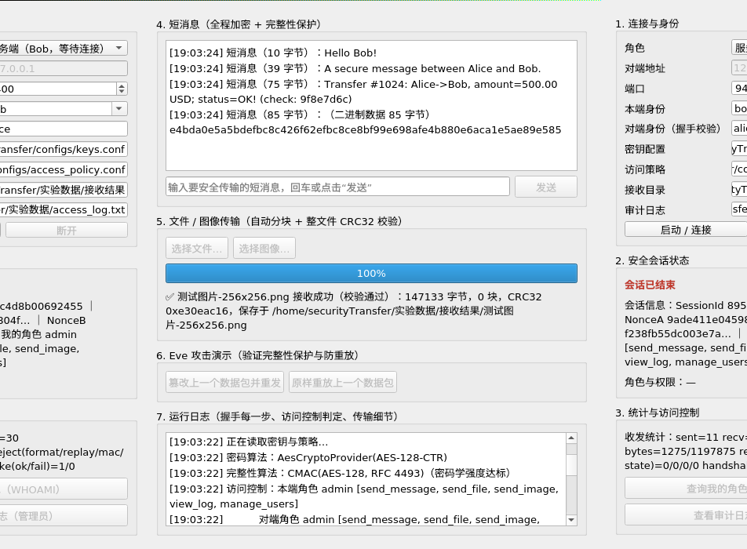
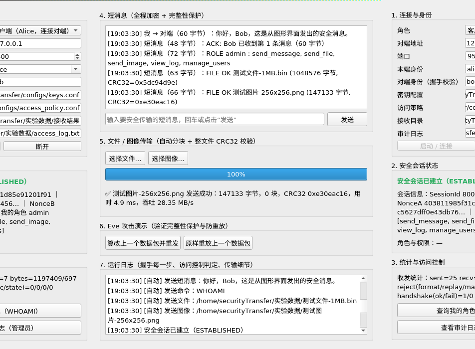

# 图形界面（课程要求 8）

> 课程要求 8：**有良好的人机交互界面、合适的应用需求分析、合理的应用设计**（加分项）。
> 本文说明界面的方案选择、功能设计、运行方式与已知限制。
>
> **2026-10-01 更新**：项目已迁移到 Windows，界面在 Windows 上也能编译运行
> （MSYS2 `mingw-w64-x86_64-qt5`，Qt 5.15.19），见本文 §10。

---

## 1. 结论摘要

| 项目 | 内容 |
| --- | --- |
| 技术栈 | **Qt 5.12 Widgets（C++）**，与安全内核同一进程，直接调用 `SecureSession` / `FileSender` / `AccessController` |
| 代码量 | 3 个源文件约 1100 行（`apps/ui/main.cpp`、`main_window.*`、`session_worker.*`） |
| 界面语言 | 中文（少量通用术语用英文，如 SessionId、CRC32、IMAGE） |
| 运行位置 | 虚拟机桌面（`DISPLAY=:0`） |
| 截图 | [`docs/screenshots/`](screenshots/README.md)（服务端视角 + 客户端视角各一张） |
| 关键设计 | **界面不实现任何密码学逻辑**：加密 / 完整性 / 认证 / 密钥分发 / 防重放 / 访问控制全部复用已有模块 |

## 2. 需求分析（界面要解决什么问题）

课程要求"使上述安全操作尽量对用户透明"。所以界面要解决三件事：

1. **用户不需要敲命令**：连接对象、端口、身份、策略都能在界面上选；
2. **安全过程可见但不需要理解**：握手每一步、会话标识、算法、角色权限、收发包统计都自动显示，
   用户只看到"已建立安全会话 / 已安全发送"；
3. **能演示与验证**：文件 / 图像传输有进度与校验结果，攻击演示有一键按钮，
   被访问控制拒绝时给出明确原因。

## 3. 界面分区

| 区域 | 控件 | 作用 |
| --- | --- | --- |
| 1. 连接与身份 | 角色（客户端/服务端）、对端地址、端口、本端身份、对端身份、密钥配置、访问策略、接收目录、审计日志、[启动/连接] [断开] | 一个界面既能当 Alice 也能当 Bob；身份可从 alice / eve / mallory / bob 里选 |
| 2. 安全会话状态 | 状态灯 + 会话信息（SessionId、NonceA/B、我的角色与权限） | 会话是否建立一目了然；SessionId 与 Nonce 是"本次会话"的指纹 |
| 3. 统计与访问控制 | 收发统计（收发包数、拒绝计数）+ [查询我的角色] [查看审计日志] | 对应 `CMD WHOAMI` / `CMD VIEW_LOG`；后者仅管理员可用 |
| 4. 短消息 | 历史记录 + 输入框 + [发送] | 明文直接输入，加密在后台完成 |
| 5. 文件 / 图像传输 | [选择文件…] [选择图像…] + 进度条 + 结果标签 | 走第四轮实现的分块 / 单包传输，显示 CRC32 校验结果 |
| 6. Eve 攻击演示 | [篡改上一个数据包并重发] [原样重放上一个数据包] | 一键验证完整性保护与防重放（对端会拒绝并记录） |
| 7. 运行日志 | 滚动日志 | 握手每一步、访问控制判定、传输细节都写在这里 |

## 4. 关键设计决策

### 4.1 线程模型：安全会话跑在独立线程

`SecureSession::receiveMessage()` 是阻塞调用，直接放在 GUI 线程里会让界面卡死。
因此：

* **GUI 线程**只画界面，把"发消息 / 发文件 / 发命令"塞进一个加锁队列；
* **工作线程**独占 `SecureSession`（该对象不是线程安全的），循环做
  "先执行队列里的命令 → 再用 250 ms 超时轮询接收"；
* 结果通过 Qt 信号发回 GUI 线程（自动跨线程排队），界面始终可交互。

代价：接收采用 250 ms 轮询，因此对端消息最多延迟 250 ms 显示（演示场景足够）。

### 4.2 界面与安全内核解耦

界面**没有**任何加密、MAC、密钥派生代码，只是调用：

```cpp
SecureSession      // 握手 + 加密数据通道
transfer::FileSender / TransferReceiver   // 文件 / 图像
access::AccessController                  // 访问控制与审计
```

这样既满足课程要求 4（密码算法必须自己写，且不会被界面"绕过"），
也意味着界面代码量小（约 1100 行）而功能完整。

### 4.3 可脚本化（`--auto`）

界面支持命令行参数，便于演示与自动截图：

```bash
./st_ui --help
./st_ui --server --id bob --peer alice --port 9400 --auto
./st_ui --client --auto --send-text "你好" --cmd WHOAMI \
    --send-file /path/test_file_1MB.bin --send-image /path/test_image_256x256.png
```

## 5. 界面截图



上图：图形界面作为**服务端**接收命令行 Alice 的消息、ACCESS/审计、1 MB 文件与图像。



上图：图形界面作为**客户端**，自动发送中文短消息、查询角色、发 1 MB 文件与图像。

（截图的获取方式见 [`screenshots/README.md`](screenshots/README.md)。）

## 6. 实测结果

在虚拟机桌面里跑完整流程（`scripts/ui_demo.sh`）：

| 场景 | 结果 |
| --- | --- |
| 图形界面作服务端（Bob, admin） | 命令行 Alice 驱动：4 条短消息 + `WHOAMI` + `VIEW_LOG` + 1 MB 文件（16 块，CRC32 校验通过）+ 图像（单包，147 KB），界面日志完整记录握手 7 步 |
| 图形界面作客户端（Alice, admin） | 界面自动发送：中文短消息（对端显示 `你好，Bob，这是从图形界面发出的安全消息。`）+ `WHOAMI` + 1 MB 文件 + 图像，全部成功 |
| 访问控制 | 界面显示角色与权限；被拒绝的操作在日志里给出 `【访问控制拒绝】…` 并说明原因 |
| 审计日志 | 本轮共 51 条 ALLOW/DENY 记录（与命令行版本行为一致） |

## 7. 运行方式

```bash
# 1. 虚拟机里安装 Qt 开发包（只需一次，约 100 MB）
sudo apt install -y qtbase5-dev

# 2. 编译（Qt 不存在时该目标会自动跳过，不影响命令行程序）
cd /home/securityTransfer && mkdir -p build && cd build
cmake .. && cmake --build . -j4
ls -l st_ui

# 3. 在桌面会话里运行
DISPLAY=:0 ./st_ui
```

一键演示（含自动截图）：

```bash
bash scripts/ui_demo.sh          # 需要虚拟机桌面会话（DISPLAY=:0）
```

## 8. 已知限制

1. **接收采用 250 ms 轮询**（因为 `SecureSession` 的接收是阻塞接口），
   对端消息最多延迟 250 ms；如果以后给 `SecureSession` 增加一个
   "非阻塞尝试接收" 接口，可以去掉轮询并进一步降低延迟；
2. 判断"接收失败是不是超时"目前依赖错误文本（`SecureSession` 未暴露 `Network::Result`），
   已在代码注释中标注为已知妥协；
3. 界面一次只服务一个会话（与命令行版本一致，服务端单连接）；
4. 文件发送在界面上是"选一个发一个"，没有做发送队列 / 断点续传；
5. 攻击演示按钮会**导致对端拒绝并终止会话**（这正是演示目的），演示后需要重新连接。

## 9. 本轮发现并修复的问题（值得写进复盘）

第一次用"图形界面作客户端 + 命令行 Bob"联调时，出现了**消息死循环**：
界面收到 Bob 的确认消息后又自动回了一条确认，Bob 再回确认……短时间内产生了
**34,000+ 条消息、12.8 MB 审计日志**。

原因：两端都对"收到的消息"自动回确认，而确认本身也是消息。

修复：约定**自动回复统一以 `ACK:` 开头**，收到 `ACK:` / `FILE OK` / `ROLE ` /
`AUDIT LOG` 等"回复型"消息时不再自动回复（`include/common/demo_reply.h`）。
修复后同样的演示只产生 51 条审计记录。

教训：**任何"自动回应"机制都必须有终止条件**；演示用的自动回复虽然与安全性无关，
但同样会把系统打爆。这也说明"端到端联调"不能只测理想路径。

---

## 10. Windows 侧运行（2026-10-01，迁移后）

| 项 | Linux（原） | Windows（迁移后） |
| --- | --- | --- |
| Qt | Qt 5.12 Widgets（`qtbase5-dev`） | Qt **5.15.19**（MSYS2 `mingw-w64-x86_64-qt5`） |
| 编译器 | g++ 9.4.0 | MinGW-w64 g++ 16.2.0 |
| 构建 | `cmake .. && cmake --build .` | `cmake -S . -B build-win -G Ninja -DCMAKE_BUILD_TYPE=Release && cmake --build build-win` |
| 结果 | 可运行，截图 `ui_client.png` / `ui_server.png` | **0 错误 0 警告**；可运行，截图 `windows_ui_client.png` |
| 代码改动 | — | **界面代码零改动**（只加了 `stconsole::ensureUtf8()` 一行，解决控制台中文乱码） |

**运行注意**：`st_ui.exe` 依赖 `Qt5Core.dll / Qt5Gui.dll / Qt5Widgets.dll`，
直接双击会因为找不到 DLL 而失败（错误码 `0xC0000135`）。把
`D:\AppGallery\dev-tools\msys64\mingw64\bin` 加进 `PATH` 即可；
或者用 `windeployqt` 打包后单独分发。

**自动化验证**（不需要人工点击）：界面支持 `--auto` 与 `--send-text / --send-file / --cmd`，
两个实例就能跑完整会话（离屏平台 `QT_QPA_PLATFORM=offscreen` 也行）：

```bash
./build-win/st_ui.exe --server --auto --port 9820 --out-dir experiment_data/received_ui &
./build-win/st_ui.exe --client --auto --host 127.0.0.1 --port 9820 \
    --send-text "Hello from Qt UI on Windows" \
    --send-file experiment_data/test_file_64KB.bin --cmd WHOAMI
```

实测：握手 7 步全部完成；`ALLOW alice(admin) send_message / send_file`；
文件 65536 字节、1 块、CRC32 校验通过，接收文件 sha256 与源文件一致。

**已知问题（迁移前就存在，尚未修改）**：空闲时 250 ms 轮询会把每次
`recv()` 超时按 ERROR 级别打到控制台，几秒钟就刷出几百行
`recv() 超时，已接收 0/4 字节`。功能与安全判定不受影响，
但日志噪声大。可选改法见 `Part2_transfer.md` §23.10（降级为 DEBUG /
给 `SecureSession` 加非阻塞尝试接收 / 仅在界面层静默），需用户决策后再做。
